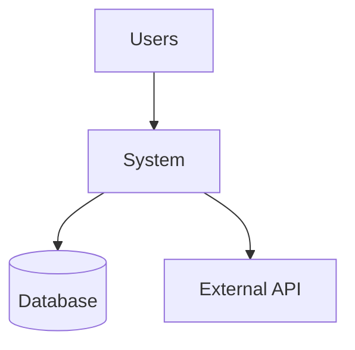

# Confluence Documentation Templates

**Version**: 2.0.0
**Plugin**: confluence-document-creator
**Purpose**: Standard templates and formatting guidelines for Confluence documentation

## Overview

This skill provides standardized templates and formatting guidelines for creating professional Confluence documentation that is consistent, clear, and easy to navigate. Use these templates when generating API documentation, architecture docs, runbooks, and release notes.

## Core Principles

1. **Consistency**: Use consistent structure across all documentation
2. **Clarity**: Write clear, concise content with good information hierarchy
3. **Navigability**: Use table of contents, headings, and links effectively
4. **Visual Appeal**: Use formatting, tables, and diagrams to enhance readability
5. **Maintainability**: Structure documents for easy updates

## Standard Page Structure

### Header Section
```markdown
# [Document Title]

**Last Updated**: [Date]
**Version**: [Version Number]
**Author**: [Author/Team]
**Status**: [Draft/Review/Approved/Published]

## Quick Links
- [Related Documentation]
- [Team Contact]
- [Source Repository]
```

### Table of Contents
Always include TOC for documents longer than 3 sections:
```markdown
## Table of Contents
1. [Overview](#overview)
2. [Section 1](#section-1)
3. [Section 2](#section-2)
...
```

### Body Structure
```markdown
## Overview
[Executive summary - 2-3 paragraphs max]

## [Main Section 1]
[Content with subsections as needed]

### [Subsection 1.1]
[Detailed content]

### [Subsection 1.2]
[Detailed content]

## [Main Section 2]
...
```

### Footer Section
```markdown
---

## Related Documentation
- [Link 1]
- [Link 2]

## Support
For questions: [contact information]

## Changelog
- [Date]: [Change description]
```

## API Documentation Template

```markdown
# [API Name] API Documentation

**Base URL**: https://api.example.com/v1
**Version**: 1.0
**Last Updated**: 2026-01-16

## Table of Contents
- [Overview](#overview)
- [Authentication](#authentication)
- [Endpoints](#endpoints)
- [Error Handling](#error-handling)
- [Examples](#examples)

## Overview
[Brief API description - what it does, who uses it]

## Authentication
**Type**: [Bearer Token / API Key / OAuth 2.0]

**Header**:
```
Authorization: Bearer YOUR_TOKEN
```

## Endpoints

### [Resource Name]

#### GET /api/resource
**Description**: [What this endpoint does]

**Authentication**: Required/Not Required

**Query Parameters**:
| Name | Type | Required | Default | Description |
|------|------|----------|---------|-------------|
| param1 | string | Yes | - | Description |
| param2 | int | No | 10 | Description |

**Response (200 OK)**:
```json
{
  "data": [...],
  "metadata": {...}
}
```

**Error Responses**:
- `400 Bad Request` - Invalid parameters
- `401 Unauthorized` - Missing authentication
- `404 Not Found` - Resource not found

**Example**:
```bash
curl -X GET "https://api.example.com/v1/api/resource?param1=value" \
  -H "Authorization: Bearer YOUR_TOKEN"
```

## Error Handling
[Standard error response format and codes]

## Examples
[Complete usage examples]
```

## Architecture Documentation Template

```markdown
# [System Name] Architecture Documentation

**Last Updated**: 2026-01-16
**Status**: Current

## Table of Contents
- [Executive Summary](#executive-summary)
- [System Context](#system-context)
- [Architecture Overview](#architecture-overview)
- [Components](#components)
- [Data Architecture](#data-architecture)
- [Technology Stack](#technology-stack)

## Executive Summary
[High-level overview - purpose, key decisions, technology choices]

## System Context
[System boundary, external actors, external systems]



## Architecture Overview
[Architectural style, patterns used, rationale]

## Components

### [Component Name]
**Responsibility**: [What it does]
**Technology**: [Tech stack]
**Dependencies**: [Other components it depends on]
**Key Files**: [Important files/directories]

## Data Architecture
[Database design, data flow, data storage]

## Technology Stack
| Layer | Technology |
|-------|------------|
| Frontend | [Technology] |
| Backend | [Technology] |
| Database | [Technology] |
| Infrastructure | [Technology] |
```

## Runbook Template

```markdown
# [Service Name] Operational Runbook

**Service**: [Service Name]
**Team**: [Team Name]
**Last Updated**: 2026-01-16
**On-Call Contact**: [Contact Info]

## Table of Contents
- [Service Overview](#service-overview)
- [Deployment](#deployment)
- [Operations](#operations)
- [Monitoring](#monitoring)
- [Troubleshooting](#troubleshooting)
- [Incident Response](#incident-response)

## Service Overview
**Purpose**: [What the service does]
**Dependencies**: [Services it depends on]
**Health Check**: [Health check URL]

## Deployment

### Prerequisites
- [ ] Item 1
- [ ] Item 2

### Deployment Steps
1. Step 1
   ```bash
   command example
   ```
2. Step 2
3. Verification
   ```bash
   verification command
   ```

### Rollback Procedure
1. Rollback step 1
2. Rollback step 2

## Operations

### Start Service
```bash
command to start
```

### Stop Service
```bash
command to stop
```

### Restart Service
```bash
command to restart
```

### Check Status
```bash
command to check status
```

## Monitoring

### Key Metrics
| Metric | Normal Range | Alert Threshold |
|--------|--------------|-----------------|
| Response Time | < 200ms | > 500ms |
| Error Rate | < 1% | > 5% |

### Health Check
- URL: [health check URL]
- Expected Response: [expected response]

## Troubleshooting

### Issue: [Common Problem]
**Symptoms**: [What you see]
**Diagnosis**:
1. Check logs: `tail -f /var/log/service.log`
2. Check status: `systemctl status service`

**Resolution**:
1. Step to resolve
2. Verification step

### Issue: [Another Problem]
...

## Incident Response

### Severity Levels
- **P1 (Critical)**: Service down, immediate action
- **P2 (High)**: Degraded performance
- **P3 (Medium)**: Minor issue, no user impact

### Escalation
1. First Contact: [Name/Contact]
2. Escalation: [Name/Contact]
3. Manager: [Name/Contact]
```

## Release Notes Template

```markdown
# Release Notes - Version [X.Y.Z]

**Release Date**: 2026-01-16
**Release Type**: [Major/Minor/Patch]

## Release Summary
[2-3 paragraph overview of the release - highlights, theme, key changes]

## What's New
### [Major Feature 1]
[Description of feature - what it does, why it matters, how to use]

### [Major Feature 2]
[Description]

## Breaking Changes
⚠️ **IMPORTANT**: This release contains breaking changes.

### [Breaking Change 1]
**What Changed**: [Description]
**Impact**: [Who is affected]
**Migration Guide**:
1. Step 1
2. Step 2

**Before**:
```code
old code example
```

**After**:
```code
new code example
```

## Features
- Feature 1 description
- Feature 2 description

## Improvements
- Improvement 1
- Improvement 2

## Bug Fixes
- Fixed: Issue description
- Fixed: Another issue

## Security
- Security fix description

## Known Issues
- Known issue 1 and workaround
- Known issue 2

## Upgrade Instructions

### Prerequisites
- [ ] Prerequisite 1
- [ ] Prerequisite 2

### Upgrade Steps
1. Backup current version
2. Stop services
3. Deploy new version
4. Run migrations
5. Start services
6. Verify deployment

### Rollback Procedure
[Steps to rollback if needed]

## Contributors
Thank you to all contributors:
- Contributor 1
- Contributor 2
```

## Formatting Guidelines

### Headings
- Use hierarchical headings (H1 → H2 → H3)
- H1 for page title only
- H2 for major sections
- H3 for subsections
- Avoid skipping levels (H2 → H4)

### Lists
- Use bulleted lists for unordered items
- Use numbered lists for sequential steps
- Use checkboxes for action items

### Code Blocks
Always specify language for syntax highlighting:
```json
{
  "example": "json"
}
```

```bash
# Shell commands
command example
```

```csharp
// C# code
public class Example { }
```

### Tables
Use tables for structured data:
| Column 1 | Column 2 | Column 3 |
|----------|----------|----------|
| Data 1   | Data 2   | Data 3   |

### Callouts
Use for important information:
```
⚠️ **WARNING**: Critical information
ℹ️ **INFO**: General information
✅ **SUCCESS**: Positive outcome
❌ **ERROR**: Problem or issue
```

### Links
- Use descriptive link text (not "click here")
- Link to related documentation
- Link to source code when relevant

### Images/Diagrams
- Use Mermaid for diagrams when possible
- Include alt text for images
- Keep diagrams simple and focused

## Confluence-Specific Markup

### Macros
```
{toc}                           # Table of contents
{code:language}..{code}         # Code block
{info}..{info}                  # Info panel
{warning}..{warning}            # Warning panel
{note}..{note}                  # Note panel
{expand}..{expand}              # Expandable section
```

### Color Highlighting
```
{color:red}Important text{color}
{color:green}Success message{color}
{color:blue}Information{color}
```

## Best Practices

1. **Write for Your Audience**: Consider who will read the documentation
2. **Be Concise**: Remove unnecessary words, get to the point
3. **Use Active Voice**: "Click the button" not "The button should be clicked"
4. **Provide Examples**: Show, don't just tell
5. **Keep Updated**: Add "Last Updated" dates and maintain changelog
6. **Link Generously**: Connect related documentation
7. **Use Visuals**: Diagrams and tables improve understanding
8. **Test Examples**: Ensure code examples actually work
9. **Version Documentation**: Match docs to software versions
10. **Review Before Publishing**: Check for accuracy and clarity

## Accessibility

- Use clear, descriptive headings
- Provide alt text for images
- Use sufficient color contrast
- Don't rely solely on color to convey meaning
- Use semantic HTML/Markdown
- Keep language simple and clear

## Review Checklist

Before publishing documentation:
- [ ] Title and metadata complete
- [ ] Table of contents accurate
- [ ] All sections complete
- [ ] Code examples tested
- [ ] Links working
- [ ] Spelling and grammar checked
- [ ] Formatting consistent
- [ ] Version numbers correct
- [ ] Last updated date current
- [ ] Related documentation linked

---

**Template Version**: 2.0.0
**Last Updated**: 2026-01-16
**Usage**: Reference these templates when generating documentation
