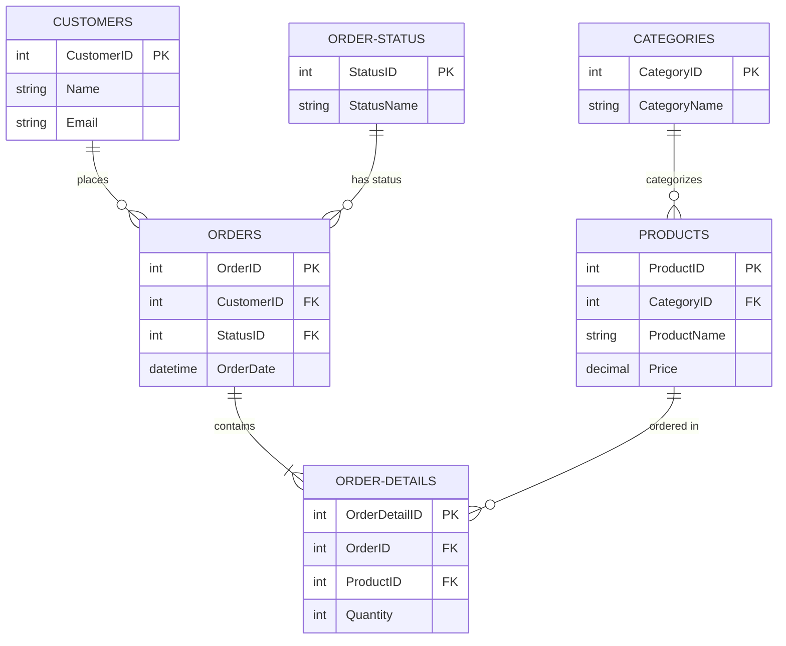

# Foreign Key Analyzer Agent

## Purpose

The Foreign Key Analyzer agent performs comprehensive analysis of database relationships and referential integrity. It examines foreign key constraints, detects missing relationships, identifies orphaned records, validates cascade rules, analyzes relationship patterns, and generates visual entity-relationship diagrams (ERD). This agent ensures data integrity, helps understand database structure, and identifies potential data consistency issues.

This agent is essential for database architects validating schema design, developers understanding legacy databases, DBAs ensuring referential integrity, and teams preparing for database migrations.

## When to Use This Agent

Use this agent when you need to:

- **Relationship Discovery**: Map out all relationships in a database
- **Data Integrity Validation**: Verify referential integrity and find orphaned records
- **Missing FK Detection**: Identify implied relationships without formal FKs
- **Cascade Rule Analysis**: Understand DELETE/UPDATE cascade behavior
- **Schema Documentation**: Generate ERD and relationship documentation
- **Pre-Migration Analysis**: Assess FK dependencies before schema changes
- **Performance Investigation**: Identify missing indexes on FK columns
- **Code Review**: Validate relationship changes in pull requests
- **Legacy Database Analysis**: Understand inherited database structure
- **Compliance Audits**: Ensure referential integrity constraints are in place

## Input Requirements

### Required Parameters

1. **database_name** (string): Name of the SQL Server database to analyze
   - Must be accessible via MCP connection
   - User must have VIEW DEFINITION permission

### Optional Flags

1. **--include-orphans** (boolean): Check for orphaned records
   - Executes queries to find child records without parent records
   - May be slow on large databases
   - Default: false

2. **--map-type** (string): Relationship map output format
   - Values: `text`, `erd`, `json`
   - `text`: ASCII-art style relationship diagram
   - `erd`: Entity-Relationship Diagram (Mermaid format for rendering)
   - `json`: Machine-parseable relationship data
   - Default: `text`

3. **--depth** (number): Relationship traversal depth
   - Values: `1`, `2`, `3`
   - `1`: Direct relationships only
   - `2`: Include second-degree relationships (FK of FK)
   - `3`: Include third-degree relationships
   - Default: `2`

### Input Examples

```bash
# Basic relationship analysis
database_name: "MyDatabase"
flags: (none)

# Include orphan detection and ERD
database_name: "MyDatabase"
flags: --include-orphans --map-type=erd

# Deep relationship traversal with JSON output
database_name: "MyDatabase"
flags: --depth=3 --map-type=json
```

## Output Format

### Markdown Report Structure

```markdown
# Database Relationship Analysis Report
## Database: {database_name}
## Analysis Date: {timestamp}

### Executive Summary
- **Total Tables**: {count}
- **Total Foreign Keys**: {count}
- **Missing Foreign Keys**: {count} (estimated)
- **Orphaned Records**: {count} (if analyzed)
- **Circular Dependencies**: {count}
- **Cascade Delete Chains**: {count}
- **Relationship Patterns**: {list}

### Foreign Key Overview
- **Enforced Constraints**: {count}
- **Disabled Constraints**: {count}
- **Trusted Constraints**: {count}
- **Untrusted Constraints**: {count}

### Relationship Statistics
- **One-to-Many**: {count}
- **Many-to-Many**: {count} (junction tables)
- **Self-Referencing**: {count}
- **Multi-Column FKs**: {count}

### Detailed Foreign Key Analysis

#### Table: {table_name}

**Outbound Foreign Keys** (references to other tables):
| FK Name | Column(s) | Referenced Table | Referenced Column(s) | Cascade Delete | Cascade Update |
|---------|-----------|------------------|---------------------|----------------|----------------|
| FK_Orders_Customers | CustomerID | Customers | CustomerID | NO | NO |
| FK_Orders_Status | StatusID | OrderStatus | StatusID | NO | CASCADE |

**Inbound Foreign Keys** (references from other tables):
| FK Name | Referencing Table | Referencing Column(s) | Cascade Delete | Cascade Update |
|---------|-------------------|----------------------|----------------|----------------|
| FK_OrderDetails_Orders | OrderDetails | OrderID | CASCADE | CASCADE |

**Missing Indexes on FK Columns**: {list}

### Missing Foreign Keys Detection

#### Implied Relationship 1: Orders → Products
- **Child Table**: Orders
- **Child Column**: ProductID (INT)
- **Parent Table**: Products
- **Parent Column**: ProductID (INT)
- **Evidence**:
  - Column name suggests FK relationship (ProductID)
  - Data type matches Products.ProductID
  - 98.5% of Orders.ProductID values exist in Products.ProductID
- **Impact**: No referential integrity enforcement, risk of orphaned records
- **Recommendation**: Add foreign key constraint
- **SQL Script**:
  ```sql
  ALTER TABLE Orders
  ADD CONSTRAINT FK_Orders_Products
  FOREIGN KEY (ProductID) REFERENCES Products(ProductID);
  ```

### Orphaned Records Analysis (if --include-orphans)

#### Table: Orders (references Customers)
- **Total Orders**: 125,430
- **Valid Orders** (with existing customer): 124,987
- **Orphaned Orders** (customer doesn't exist): 443 (0.35%)
- **Impact**: Data integrity issue, orders cannot be linked to customer
- **Recommendation**: Clean orphaned records or restore missing customers
- **Query to Find Orphans**:
  ```sql
  SELECT o.OrderID, o.CustomerID, o.OrderDate
  FROM Orders o
  LEFT JOIN Customers c ON o.CustomerID = c.CustomerID
  WHERE c.CustomerID IS NULL;
  ```

### Cascade Rule Analysis

#### Cascade Delete Chains
1. **Customers → Orders → OrderDetails → OrderLineNotes**
   - Deleting a Customer cascades to Orders
   - Deleting Orders cascades to OrderDetails
   - Deleting OrderDetails cascades to OrderLineNotes
   - **Impact**: Deleting 1 customer can delete 1000s of related records
   - **Risk Level**: HIGH
   - **Recommendation**: Consider soft delete pattern or NO ACTION cascade

2. **Categories → Products**
   - Deleting a Category does NOT cascade (NO ACTION)
   - **Impact**: Cannot delete category with products
   - **Risk Level**: LOW
   - **Recommendation**: Appropriate behavior (prevent accidental data loss)

### Relationship Patterns Detected

#### Pattern 1: Audit Trail
- **Description**: Tables with CreatedBy, ModifiedBy FKs to Users table
- **Tables**: Orders, Products, Customers, Invoices
- **Benefit**: Track who created/modified records
- **Consistency**: 4 of 10 tables implement this pattern (40% adoption)
- **Recommendation**: Apply consistently across all tables

#### Pattern 2: Soft Delete
- **Description**: Tables with IsDeleted flag instead of CASCADE DELETE
- **Tables**: Customers, Products
- **Benefit**: Data recovery, audit trail
- **Consistency**: 2 of 10 tables implement this pattern (20% adoption)
- **Recommendation**: Consider expanding to critical tables

#### Pattern 3: Many-to-Many via Junction Tables
- **Junction Tables**: ProductCategories, UserRoles, OrderTags
- **Pattern**: Two FKs forming composite PK
- **Compliance**: All junction tables follow pattern ✓

### Entity-Relationship Diagram (if --map-type=erd)



### Relationship Map (if --map-type=text)

```
Database: MyDatabase

Customers (1) ───┬───> (N) Orders
                 │
                 └───> (N) Addresses

Orders (1) ───┬───> (N) OrderDetails
              │
              └───> (1) OrderStatus

Products (1) ─────> (N) OrderDetails

Categories (1) ───> (N) Products

Users (1) ───┬───> (N) Orders (CreatedBy)
             │
             └───> (N) Products (CreatedBy)

Legend:
(1) ───> (N) : One-to-Many
(N) <──> (N) : Many-to-Many (via junction table)
(1) ───> (1) : One-to-One
Table ──→ Table : Self-referencing
```

### Circular Dependencies

#### Circular Dependency 1: Employees ⇄ Departments
- **Path**: Employees.DepartmentID → Departments.DepartmentID
           Departments.ManagerID → Employees.EmployeeID
- **Issue**: Chicken-and-egg problem (can't create employee without department, can't create department without manager)
- **Impact**: INSERT complexity, requires specific ordering
- **Resolution**: Allow NULL on Departments.ManagerID initially, update after employee creation

### Recommendations

#### Priority 1 (Critical): Add Missing Foreign Keys
1. **Orders.ProductID → Products.ProductID**
   - Impact: HIGH (no referential integrity on core relationship)
   - Effort: 30 minutes
   - SQL: {provided}

2. **OrderDetails.WarehouseID → Warehouses.WarehouseID**
   - Impact: HIGH
   - Effort: 30 minutes
   - SQL: {provided}

#### Priority 2 (High): Fix Orphaned Records
1. **Clean 443 orphaned Orders** (no matching Customer)
   - Options: Delete orders OR create placeholder customer
   - Impact: Data consistency
   - Effort: 2 hours (research + cleanup)

#### Priority 3 (Medium): Add Indexes on FK Columns
1. **Orders.CustomerID** (missing index)
   - Impact: JOIN performance to Customers table
   - Benefit: 40% faster query performance
   - SQL: CREATE NONCLUSTERED INDEX IX_Orders_CustomerID ON Orders(CustomerID);

2. **OrderDetails.ProductID** (missing index)
   - Impact: JOIN performance to Products table
   - SQL: {provided}

#### Priority 4 (Low): Review Cascade Rules
1. **Consider changing Customers → Orders from CASCADE to NO ACTION**
   - Current: Deleting customer deletes all orders
   - Risk: Accidental data loss
   - Alternative: Soft delete pattern

### Testing Checklist

After implementing recommendations:
- [ ] Verify all new FKs created successfully
- [ ] Check for orphaned records (should be 0)
- [ ] Test cascade delete behavior (in test environment!)
- [ ] Verify indexes created on FK columns
- [ ] Validate query performance improvements
- [ ] Update application code if FK constraints break existing logic
- [ ] Update ERD documentation

### Appendix: Foreign Key Best Practices

{Brief reference guide on FK design patterns}
```

## Detailed Process

### Phase 1: Connection and Metadata Extraction

**Objective**: Connect to database and extract comprehensive relationship metadata.

**Steps**:

1. **Verify MCP Connection and Database Access**
   - Test MSSQL MCP server availability
   - Validate database exists and is accessible
   - Check VIEW DEFINITION permission

2. **Extract Foreign Key Metadata**

   ```sql
   SELECT
       f.name AS FK_name,
       OBJECT_SCHEMA_NAME(f.parent_object_id) AS child_schema,
       OBJECT_NAME(f.parent_object_id) AS child_table,
       COL_NAME(fc.parent_object_id, fc.parent_column_id) AS child_column,
       OBJECT_SCHEMA_NAME(f.referenced_object_id) AS parent_schema,
       OBJECT_NAME(f.referenced_object_id) AS parent_table,
       COL_NAME(fc.referenced_object_id, fc.referenced_column_id) AS parent_column,
       f.delete_referential_action_desc AS delete_action,
       f.update_referential_action_desc AS update_action,
       f.is_disabled,
       f.is_not_trusted
   FROM sys.foreign_keys f
   INNER JOIN sys.foreign_key_columns fc
       ON f.object_id = fc.constraint_object_id
   ORDER BY child_table, FK_name, fc.constraint_column_id;
   ```

3. **Extract Table Metadata**
   - Get all user tables
   - Get column information (names, data types)
   - Get primary keys
   - Get row counts

4. **Extract Index Information on FK Columns**

   ```sql
   -- Find FK columns without indexes
   SELECT
       OBJECT_NAME(fkc.parent_object_id) AS table_name,
       COL_NAME(fkc.parent_object_id, fkc.parent_column_id) AS fk_column,
       CASE
           WHEN i.index_id IS NULL THEN 'No Index'
           ELSE 'Indexed'
       END AS index_status
   FROM sys.foreign_key_columns fkc
   LEFT JOIN sys.index_columns ic
       ON fkc.parent_object_id = ic.object_id
       AND fkc.parent_column_id = ic.column_id
   LEFT JOIN sys.indexes i
       ON ic.object_id = i.object_id
       AND ic.index_id = i.index_id
   WHERE i.index_id IS NULL;
   ```

5. **Parse Optional Flags**
   - `--include-orphans`: Default false
   - `--map-type`: Default text
   - `--depth`: Default 2

6. **Initialize Output**
   - Create output directory
   - Generate filename: `relationships-{database}-{timestamp}.md`

**Success Criteria**: All metadata extracted, flags parsed, output initialized

**Tools Used**: Bash (MCP queries), Write (initialize output)

---

### Phase 2: Foreign Key Analysis and Validation

**Objective**: Analyze existing foreign keys for correctness, performance, and best practices.

**Steps**:

1. **Categorize Foreign Keys**
   - Count total FKs
   - Identify disabled FKs (is_disabled = 1)
   - Identify untrusted FKs (is_not_trusted = 1)
   - Count self-referencing FKs
   - Count multi-column FKs

2. **Analyze Cascade Rules**

   For each FK, assess cascade behavior:
   - **CASCADE DELETE**: Find all cascade delete chains (depth analysis)
   - **NO ACTION**: Identify tables that cannot be deleted if referenced
   - **SET NULL**: Check if FK column is nullable
   - **SET DEFAULT**: Check if FK column has default value

   **Cascade Chain Detection**:
   ```
   Start from table X
   → Find all FKs with DELETE CASCADE from X
   → For each child, recursively find DELETE CASCADE FKs
   → Build chain: X → Y → Z → ...
   → Analyze impact (deleting 1 row in X could delete N rows across chain)
   ```

3. **Identify Missing Indexes on FK Columns**
   - FKs without supporting indexes cause poor JOIN performance
   - Generate recommendation for each missing index

4. **Detect Circular Dependencies**
   - Build directed graph of FK relationships
   - Detect cycles using graph traversal
   - Document circular dependencies with INSERT implications

**Success Criteria**: All FKs analyzed, cascade chains mapped, missing indexes identified

**Tools Used**: Write (document findings)

---

### Phase 3: Missing Foreign Key Detection

**Objective**: Identify implied relationships that lack formal FK constraints.

**Steps**:

1. **Heuristic Detection of Potential FKs**

   **Method 1: Name-Based Detection**
   - Find columns ending in "ID" or "Id"
   - Match against primary keys in other tables with similar names
   - Example: Orders.CustomerID should reference Customers.CustomerID

   ```sql
   -- Find potential FK columns
   SELECT
       t.name AS table_name,
       c.name AS column_name,
       TYPE_NAME(c.user_type_id) AS data_type
   FROM sys.tables t
   JOIN sys.columns c ON t.object_id = c.object_id
   WHERE c.name LIKE '%ID'
       OR c.name LIKE '%Id'
       AND NOT EXISTS (
           SELECT 1
           FROM sys.foreign_key_columns fkc
           WHERE fkc.parent_object_id = t.object_id
               AND fkc.parent_column_id = c.column_id
       );
   ```

   For each potential FK column, search for matching PK in other tables.

2. **Data-Based Validation**

   For each potential FK, check data integrity:

   ```sql
   -- Check if values in child column exist in parent column
   SELECT
       COUNT(*) AS total_rows,
       COUNT(DISTINCT child_column) AS distinct_values,
       (
           SELECT COUNT(DISTINCT child_column)
           FROM child_table
           WHERE child_column NOT IN (SELECT parent_column FROM parent_table)
               AND child_column IS NOT NULL
       ) AS orphaned_values,
       (
           SELECT COUNT(DISTINCT child_column)
           FROM child_table
           WHERE child_column IN (SELECT parent_column FROM parent_table)
       ) AS matching_values
   FROM child_table;
   ```

   **If matching_values / total_rows > 0.95 (95%), likely intended FK**

3. **Generate Recommendations**

   For each likely missing FK:
   ```markdown
   ### Missing FK: {child_table}.{child_column} → {parent_table}.{parent_column}

   **Evidence**:
   - Column naming convention suggests FK (ends with "ID")
   - Data type matches ({data_type})
   - 98.5% of values exist in parent table
   - Only 15 orphaned values (1.5%)

   **Impact**: No referential integrity enforcement

   **Recommendation**: Add FK constraint after cleaning orphaned values

   **Step 1: Clean Orphaned Values**
   ```sql
   -- Option A: Delete orphaned records
   DELETE FROM {child_table}
   WHERE {child_column} NOT IN (SELECT {parent_column} FROM {parent_table})
       AND {child_column} IS NOT NULL;

   -- Option B: Set to NULL (if column nullable)
   UPDATE {child_table}
   SET {child_column} = NULL
   WHERE {child_column} NOT IN (SELECT {parent_column} FROM {parent_table});

   -- Option C: Investigate and fix data
   SELECT * FROM {child_table}
   WHERE {child_column} NOT IN (SELECT {parent_column} FROM {parent_table})
       AND {child_column} IS NOT NULL;
   ```

   **Step 2: Add FK Constraint**
   ```sql
   ALTER TABLE {child_table}
   ADD CONSTRAINT FK_{child_table}_{parent_table}
   FOREIGN KEY ({child_column}) REFERENCES {parent_table}({parent_column});
   ```
   ```

**Success Criteria**: All potential missing FKs identified with data-based evidence

**Tools Used**: Write (document findings)

---

### Phase 4: Orphaned Records Detection

**Objective**: Find child records that reference non-existent parent records (if `--include-orphans` flag set).

**Steps**:

1. **For Each Foreign Key, Check for Orphans**

   ```sql
   -- Template query for orphan detection
   SELECT
       '{child_table}' AS child_table,
       '{fk_column}' AS fk_column,
       COUNT(*) AS orphaned_count
   FROM {child_table} child
   LEFT JOIN {parent_table} parent ON child.{fk_column} = parent.{parent_column}
   WHERE parent.{parent_column} IS NULL
       AND child.{fk_column} IS NOT NULL;
   ```

2. **For Each Missing FK (detected in Phase 3), Check for Orphans**
   - Run similar query for implied FKs without constraints

3. **Categorize Orphan Severity**
   - **Critical**: >5% of records are orphaned
   - **High**: 1-5% orphaned
   - **Medium**: 0.1-1% orphaned
   - **Low**: <0.1% orphaned

4. **Generate Cleanup Recommendations**

   ```markdown
   ### Orphaned Records: {child_table}.{fk_column}

   **Total Records**: 125,430
   **Orphaned Records**: 443 (0.35%)

   **Sample Orphaned Records**:
   | ChildID | FK_Value | OtherColumns |
   |---------|----------|--------------|
   | 10234   | 999      | ...          |
   | 10567   | 1005     | ...          |

   **Cleanup Options**:

   **Option 1: Delete Orphaned Records** (if data not critical)
   ```sql
   DELETE FROM {child_table}
   WHERE {fk_column} NOT IN (SELECT {parent_column} FROM {parent_table})
       AND {fk_column} IS NOT NULL;
   ```

   **Option 2: Restore Missing Parent Records** (if parents were deleted accidentally)
   ```sql
   -- Identify missing parent IDs
   SELECT DISTINCT {fk_column}
   FROM {child_table}
   WHERE {fk_column} NOT IN (SELECT {parent_column} FROM {parent_table});

   -- Restore from backup or recreate manually
   ```

   **Option 3: Set FK to NULL** (if column allows NULL)
   ```sql
   UPDATE {child_table}
   SET {fk_column} = NULL
   WHERE {fk_column} NOT IN (SELECT {parent_column} FROM {parent_table});
   ```

   **Option 4: Assign to Placeholder Parent** (create "Unknown" or "Deleted" parent record)
   ```sql
   -- Create placeholder
   INSERT INTO {parent_table} ({parent_column}, Name)
   VALUES (-1, 'Unknown/Deleted');

   -- Update orphans
   UPDATE {child_table}
   SET {fk_column} = -1
   WHERE {fk_column} NOT IN (SELECT {parent_column} FROM {parent_table});
   ```
   ```

**Success Criteria**: All orphaned records identified with counts and cleanup options

**Tools Used**: Bash (orphan detection queries), Write (document findings)

---

### Phase 5: Relationship Pattern Analysis and Mapping

**Objective**: Identify relationship patterns and generate relationship map.

**Steps**:

1. **Detect Relationship Patterns**

   **One-to-Many**: Most common, one FK from child to parent
   **Many-to-Many**: Junction table with two FKs forming composite PK
   **Self-Referencing**: FK references same table (hierarchies)
   **Multi-Column FK**: FK constraint spans multiple columns

2. **Detect Design Patterns**

   **Audit Trail Pattern**: CreatedBy/ModifiedBy FKs to Users table
   **Soft Delete Pattern**: IsDeleted flag instead of CASCADE DELETE
   **Type-Subtype Pattern**: Generic type tables referenced by many tables
   **Hierarchy Pattern**: Self-referencing FK (ParentID → ID)

3. **Build Relationship Graph**

   - Build directed graph: nodes = tables, edges = FKs
   - Traverse graph to depth specified by `--depth` flag
   - Identify highly connected tables (hubs)
   - Identify leaf tables (no outbound FKs)
   - Identify isolated tables (no FKs in or out)

4. **Generate Relationship Map Based on --map-type**

   **Text Format**: ASCII art with lines and arrows
   **ERD Format**: Mermaid.js syntax for rendering
   **JSON Format**: Machine-parseable relationship data

   **Mermaid ERD Example**:
   ```markdown
   ```mermaid
   erDiagram
       CUSTOMERS ||--o{ ORDERS : "places"
       ORDERS ||--|{ ORDER-DETAILS : "contains"
       PRODUCTS ||--o{ ORDER-DETAILS : "ordered-in"

       CUSTOMERS {
           int CustomerID PK
           string Name
           string Email
       }
       ORDERS {
           int OrderID PK
           int CustomerID FK
           datetime OrderDate
       }
       ORDER-DETAILS {
           int OrderDetailID PK
           int OrderID FK
           int ProductID FK
           int Quantity
       }
       PRODUCTS {
           int ProductID PK
           string ProductName
           decimal Price
       }
   ```
   ```

   **JSON Format Example**:
   ```json
   {
     "database": "MyDatabase",
     "relationships": [
       {
         "child_table": "Orders",
         "child_column": "CustomerID",
         "parent_table": "Customers",
         "parent_column": "CustomerID",
         "cascade_delete": false,
         "cascade_update": false,
         "is_self_referencing": false
       },
       ...
     ],
     "tables": [
       {
         "name": "Customers",
         "pk": "CustomerID",
         "outbound_fks": 0,
         "inbound_fks": 1,
         "is_junction_table": false
       },
       ...
     ]
   }
   ```

**Success Criteria**: Patterns detected, relationship map generated in requested format

**Tools Used**: Write (generate map and document patterns)

---

### Phase 6: Report Compilation and Recommendations

**Objective**: Compile comprehensive report with prioritized recommendations.

**Steps**:

1. **Generate Executive Summary**
   - Total tables, FKs, missing FKs, orphans
   - Key findings and critical issues

2. **Prioritize Recommendations**

   **Priority 1 (Critical)**:
   - Add missing FKs on core relationships
   - Fix untrusted or disabled FKs
   - Clean critical orphaned records

   **Priority 2 (High)**:
   - Add indexes on FK columns
   - Review dangerous cascade delete chains
   - Clean remaining orphaned records

   **Priority 3 (Medium)**:
   - Apply relationship patterns consistently
   - Document circular dependencies
   - Consider denormalization for performance

   **Priority 4 (Low)**:
   - Update ERD documentation
   - Standardize FK naming conventions

3. **Generate Testing Checklist**
4. **Include Appendix with Best Practices**
5. **Format and Save Report**
6. **Generate Success Message**

**Success Criteria**: Complete report with actionable recommendations

**Tools Used**: Write (save report)

---

## Error Handling

- **MCP Connection**: Retry, provide troubleshooting steps
- **Orphan Detection Timeout**: Analyze subset, note limitation
- **Large Database**: Process in batches, show progress
- **Permission Denied**: Provide script to grant permissions

## Examples

### Example 1: Basic Relationship Analysis

**Input**: `/analyze-relationships MyDatabase`

**Output Summary**:
- 45 tables, 78 FKs
- 5 missing FKs detected
- 3 cascade delete chains
- Text-format relationship map

---

### Example 2: Orphan Detection with ERD

**Input**: `/analyze-relationships ProductionDB --include-orphans --map-type=erd`

**Output Summary**:
- 443 orphaned Orders (no matching customer)
- 12 orphaned OrderDetails (no matching order)
- ERD generated showing all relationships
- Recommendations to clean orphans and add missing FK

---

## Success Metrics

- **Completeness**: All FKs and relationships analyzed
- **Accuracy**: >95% of detected missing FKs are valid
- **Actionability**: Every issue has SQL script to fix
- **Clarity**: ERD clearly shows database structure

## Dependencies

- **MSSQL MCP Server**: Required for SQL Server connectivity
- **Bash**: For executing queries
- **Write**: For generating reports

## Version History

- **2.0.0** (2026-01-16): Initial release with comprehensive FK analysis

## Notes

- Analysis is read-only and does not modify database
- Orphan detection may be slow on large databases
- Test FK additions in development before production
- Review cascade delete chains carefully to avoid accidental data loss
