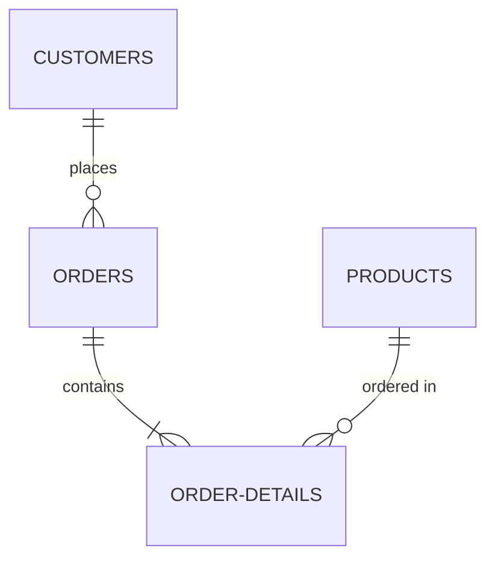
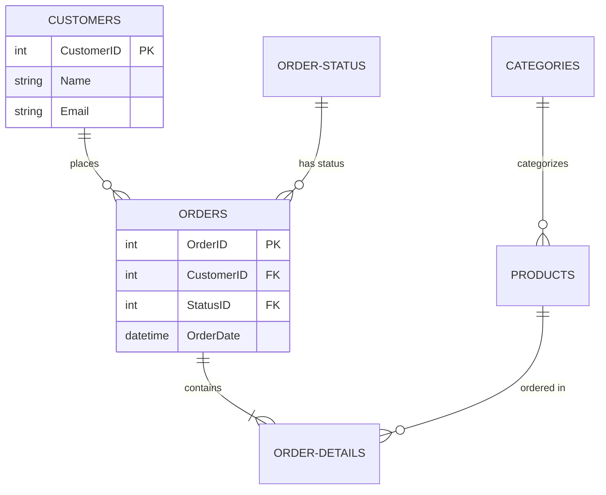

# /analyze-relationships Command

## Overview

The `/analyze-relationships` command performs comprehensive analysis of database relationships and referential integrity. It examines foreign key constraints, detects missing relationships, identifies orphaned records, validates cascade rules, analyzes relationship patterns, and generates visual entity-relationship diagrams (ERD). This command ensures data integrity, helps understand database structure, and identifies potential data consistency issues.

## Syntax

```bash
/analyze-relationships <database-name> [--include-orphans] [--map-type=erd|text|json] [--depth=1|2|3]
```

## Parameters

### Required

- **database-name** (string): Name of the SQL Server database to analyze
  - Must be accessible via MSSQL MCP server
  - User must have VIEW DEFINITION permission
  - Example: `MyDatabase`, `ProductionDB`, `LegacyDB`

### Optional Flags

#### --include-orphans

Checks for orphaned records (child records without parent records).

**What it does**:
- For each foreign key, queries for child records with no matching parent
- For detected missing FKs, checks for implied orphans
- Categorizes orphans by severity (% of total records)
- Provides cleanup recommendations (delete, restore parent, set NULL, use placeholder)

**Performance Impact**:
- May be slow on large databases (requires LEFT JOIN queries on every FK)
- Recommended to run during low-usage periods
- Timeout possible on very large tables

**When to use**:
- Data integrity audits
- Pre-migration cleanup
- Investigating data consistency issues
- After accidental data deletion

**Example**:
```bash
/analyze-relationships MyDatabase --include-orphans
```

---

#### --map-type

Specifies the format for the relationship map output.

**Values**:
- `text` (default): ASCII-art style relationship diagram (human-readable in terminal)
- `erd`: Entity-Relationship Diagram in Mermaid format (can be rendered visually)
- `json`: Machine-parseable relationship data (for automation/tooling)

**Examples**:

**Text Format**:
```
Customers (1) ───┬───> (N) Orders
                 └───> (N) Addresses

Orders (1) ───> (N) OrderDetails
Products (1) ───> (N) OrderDetails
```

**ERD Format** (Mermaid):


**JSON Format**:
```json
{
  "relationships": [
    {
      "child_table": "Orders",
      "child_column": "CustomerID",
      "parent_table": "Customers",
      "parent_column": "CustomerID"
    }
  ]
}
```

**Usage**:
```bash
/analyze-relationships MyDatabase --map-type=erd
/analyze-relationships MyDatabase --map-type=json
```

---

#### --depth

Specifies the depth of relationship traversal.

**Values**:
- `1`: Direct relationships only (immediate parent/child)
- `2` (default): Second-degree relationships (FK of FK)
- `3`: Third-degree relationships (deep traversal)

**Example Depth Levels**:

**Depth 1**:
```
Customers → Orders (stops here)
```

**Depth 2**:
```
Customers → Orders → OrderDetails (includes second level)
```

**Depth 3**:
```
Customers → Orders → OrderDetails → OrderLineNotes (full chain)
```

**When to use**:
- `--depth=1`: Quick overview of direct relationships
- `--depth=2`: Standard analysis (default, shows most important chains)
- `--depth=3`: Deep analysis for understanding complex cascades

**Usage**:
```bash
/analyze-relationships MyDatabase --depth=1
/analyze-relationships MyDatabase --depth=3
```

---

## Usage Examples

### Example 1: Basic Relationship Analysis

```bash
/analyze-relationships MyDatabase
```

**Scenario**: Understanding database structure and relationships.

**What happens**:
1. Extracts all foreign key constraints
2. Analyzes FK properties (cascade rules, enabled/disabled, trusted/untrusted)
3. Detects missing foreign keys (heuristic and data-based)
4. Identifies relationship patterns (1:N, M:N, self-referencing)
5. Generates text-format relationship map (default)
6. Provides recommendations for missing FKs and indexes

**Output**: `marketplace/marketplace/output/schema-analysis/relationships-MyDatabase-{timestamp}.md`

---

### Example 2: Orphan Detection with ERD

```bash
/analyze-relationships ProductionDB --include-orphans --map-type=erd
```

**Scenario**: Data integrity audit before critical release.

**What happens**:
1. Full relationship analysis
2. Checks for orphaned records on all FKs (may take longer)
3. Generates Mermaid ERD for visual documentation
4. Provides orphan cleanup recommendations

**Use case**:
- Pre-production data validation
- Post-incident data integrity check
- Database health audit

**Output**: Markdown report with embedded Mermaid ERD

---

### Example 3: Deep Cascade Analysis

```bash
/analyze-relationships MyDatabase --depth=3
```

**Scenario**: Understanding CASCADE DELETE impact before enabling cascade rules.

**What happens**:
1. Traverses relationships to depth 3
2. Identifies all cascade delete chains
3. Analyzes impact (deleting 1 row could cascade to N rows)
4. Provides risk assessment

**Use case**:
- Before adding CASCADE DELETE rules
- Investigating accidental bulk deletions
- Understanding referential integrity dependencies

---

### Example 4: JSON Export for Automation

```bash
/analyze-relationships AnalyticsDB --map-type=json --depth=2
```

**Scenario**: Generating relationship metadata for automated documentation or tooling.

**What happens**:
1. Full relationship analysis (depth 2)
2. Exports structured JSON with all relationships, tables, and metadata
3. Suitable for parsing by external tools

**Use case**:
- CI/CD integration
- Automated documentation generation
- Custom analysis tooling
- Database comparison scripts

**Output**: `marketplace/marketplace/output/schema-analysis/relationships-AnalyticsDB-{timestamp}.json`

---

## What Gets Analyzed

### Foreign Key Constraints

**Metadata Extracted**:
- FK constraint name
- Child table and column(s)
- Parent table and column(s)
- Cascade rules (DELETE and UPDATE)
- Enabled/disabled status
- Trusted/untrusted status

**Analysis**:
- Count of enforced vs disabled FKs
- Count of trusted vs untrusted FKs
- Multi-column FKs
- Self-referencing FKs (hierarchies)

---

### Relationship Statistics

- **One-to-Many (1:N)**: Most common, single FK from child to parent
- **Many-to-Many (M:N)**: Junction tables with two FKs forming composite PK
- **Self-Referencing**: FK references same table (organizational hierarchies, categories)
- **Multi-Column FKs**: FK constraint spans multiple columns

---

### Missing Foreign Keys

**Detection Methods**:

**Name-Based Heuristics**:
- Columns ending in "ID" or "Id" without FK constraints
- Column name matches PK name in another table (e.g., Orders.CustomerID → Customers.CustomerID)

**Data-Based Validation**:
- Check if values in potential FK column exist in potential parent table
- If >95% of values match, likely intended FK
- Identify orphaned values (missing in parent table)

**Recommendations**:
- Add missing FK constraints (with SQL script)
- Clean orphaned data first (with cleanup scripts)
- Validate data integrity

---

### Missing Indexes on FK Columns

**Detection**:
- FK columns without supporting indexes
- FK columns not included in any existing index

**Impact**:
- Slow JOIN performance
- Slow DELETE/UPDATE on parent table (needs to check children)

**Recommendations**:
- Create non-clustered indexes on FK columns
- Provide SQL script for each missing index

---

### Cascade Rule Analysis

**Cascade DELETE Chains**:
- Start from table X
- Find all FKs with CASCADE DELETE from X
- Recursively follow chain: X → Y → Z → ...
- Calculate impact (deleting 1 row in X could delete N rows across chain)

**Risk Assessment**:
- **High Risk**: Long cascade chains (>3 levels) or high multiplier (1:1000+)
- **Medium Risk**: Moderate chains (2-3 levels)
- **Low Risk**: Single-level cascades or small multipliers

**Recommendations**:
- Review dangerous cascade chains
- Consider soft delete pattern instead
- Add application-level delete logic
- Use CASCADE only when appropriate

---

### Circular Dependencies

**Detection**:
- Build directed graph of FK relationships
- Detect cycles using graph traversal

**Example**:
```
Employees.DepartmentID → Departments.DepartmentID
Departments.ManagerID → Employees.EmployeeID
```

**Issue**: Chicken-and-egg problem during INSERT
**Resolution**: Allow NULL on one FK, update after creation

---

### Orphaned Records (if --include-orphans)

**For Each Foreign Key**:
```sql
SELECT
    child.*
FROM ChildTable child
LEFT JOIN ParentTable parent ON child.FK_Column = parent.PK_Column
WHERE parent.PK_Column IS NULL
  AND child.FK_Column IS NOT NULL;
```

**Severity Classification**:
- **Critical**: >5% orphaned
- **High**: 1-5% orphaned
- **Medium**: 0.1-1% orphaned
- **Low**: <0.1% orphaned

**Cleanup Options**:
1. **Delete orphans**: If data not critical
2. **Restore missing parents**: If parents deleted accidentally
3. **Set FK to NULL**: If column allows NULL
4. **Assign to placeholder**: Create "Unknown" parent record

---

### Relationship Patterns

**Audit Trail Pattern**:
- CreatedBy, ModifiedBy FKs to Users table
- Tracks who created/modified records

**Soft Delete Pattern**:
- IsDeleted flag instead of CASCADE DELETE
- Allows data recovery

**Type-Subtype Pattern**:
- Generic TypeID FK to lookup tables
- Extensible classification system

**Hierarchy Pattern**:
- Self-referential FK (ParentID → ID)
- Tree structures (org charts, categories)

**Many-to-Many Pattern**:
- Junction table with two FKs as composite PK
- Proper M:N relationship modeling

---

## Output Report Structure

### Executive Summary
- Total tables, total FKs
- Missing FKs (estimated)
- Orphaned records (if analyzed)
- Circular dependencies
- Cascade delete chains
- Relationship patterns detected

### Foreign Key Overview
- Enforced vs disabled constraints
- Trusted vs untrusted constraints
- Self-referencing FKs
- Multi-column FKs

### Detailed FK Analysis
For each table:
- **Outbound FKs**: References to other tables
- **Inbound FKs**: References from other tables
- Missing indexes on FK columns

### Missing Foreign Keys Detection
For each likely missing FK:
- Evidence (name pattern, data validation)
- Impact of missing constraint
- Cleanup script (remove orphans)
- Add FK constraint script

### Orphaned Records Analysis (if --include-orphans)
For each FK with orphans:
- Total records, orphaned count, percentage
- Sample orphaned records
- Cleanup options with SQL scripts

### Cascade Rule Analysis
- Cascade delete chains with impact assessment
- Risk level for each chain
- Recommendations

### Relationship Map
- Text, ERD, or JSON format (based on --map-type)
- Visual representation of database relationships

### Circular Dependencies
- Detected cycles with paths
- INSERT implications
- Resolution strategies

### Recommendations
Prioritized list:
1. **Critical**: Add missing FKs on core relationships
2. **High**: Fix orphaned records, add missing indexes
3. **Medium**: Review cascade rules, apply patterns consistently
4. **Low**: Update ERD documentation, standardize naming

### Testing Checklist
- Verify new FKs created
- Check for orphans (should be 0)
- Test cascade behavior
- Verify indexes created
- Validate query performance

---

## Prerequisites

### MCP Configuration

MSSQL MCP server must be configured:

```json
{
  "mcpServers": {
    "mssql": {
      "command": "npx",
      "args": ["-y", "@modelcontextprotocol/server-mssql"],
      "env": {
        "MSSQL_CONNECTION_STRING": "Server=localhost;Database=master;Trusted_Connection=True;"
      }
    }
  }
}
```

### Required Permissions

Database user must have:
- `VIEW DEFINITION` permission
- `SELECT` permission on tables (if using --include-orphans)

```sql
USE [DatabaseName];
GRANT VIEW DEFINITION TO [UserName];
GRANT SELECT ON SCHEMA::dbo TO [UserName];
```

---

## Error Handling

### Common Errors

**Error: "Cannot connect to database"**
- Verify MCP server running
- Check database name spelling
- Ensure database is online

**Error: "Orphan detection timeout"**
- Database too large for full scan
- Run during low-usage period
- Analyze critical tables individually
- Increase timeout in configuration

**Error: "Permission denied"**
- Grant VIEW DEFINITION permission
- Grant SELECT permission (for orphan detection)

---

## Performance Considerations

**Typical Execution Times**:
- **Basic Analysis** (no orphans): 3-5 minutes
- **With Orphan Detection** (small DB): 5-10 minutes
- **With Orphan Detection** (large DB): 10-20 minutes or timeout

**Optimization Tips**:
1. **Skip orphan detection** for initial analysis (add --include-orphans only when needed)
2. **Use --depth=1** for quick overview
3. **Run during low-usage periods** for orphan detection
4. **Analyze critical tables individually** if full database times out

---

## Tips and Best Practices

1. **Add Missing FKs**: Enforce referential integrity with FK constraints
2. **Index FK Columns**: Always create indexes on FK columns for JOIN performance
3. **Review Cascade Rules**: CASCADE DELETE can be dangerous, use carefully
4. **Fix Orphans Regularly**: Run orphan detection periodically
5. **Use Soft Delete**: Consider IsDeleted flag instead of CASCADE DELETE for audit trail
6. **Document Relationships**: Keep ERD updated after schema changes
7. **Test FK Additions**: Add FKs in development first, verify data integrity
8. **Monitor Performance**: Verify index recommendations improve query speed
9. **Circular Dependencies**: Design carefully, allow NULL where needed
10. **Consistency**: Apply relationship patterns consistently across schema

---

## Integration with Other Commands

### Complete Database Analysis Workflow

```bash
# Step 1: Analyze overall schema structure
/analyze-schema MyDatabase

# Step 2: Validate normalization for key tables
/suggest-normalization MyDatabase.Users
/suggest-normalization MyDatabase.Orders

# Step 3: Analyze relationships and integrity
/analyze-relationships MyDatabase --include-orphans --map-type=erd

# Step 4: Fix issues found, then re-analyze
```

### Pre-Migration Workflow

```bash
# Step 1: Analyze relationships in source
/analyze-relationships SourceDB --depth=3

# Step 2: Analyze relationships in target
/analyze-relationships TargetDB --depth=3

# Step 3: Plan migration considering FK dependencies
/plan-schema-migration SourceDB TargetDB
```

---

## Related Commands

- **`/analyze-schema`**: Overall database schema structure analysis
- **`/suggest-normalization`**: Table normalization analysis (FK relationships are part of good design)
- **`/plan-schema-migration`**: Migration planning (must consider FK dependencies)

---

## Output Location

Reports are saved to:
```
marketplace/output/schema-analysis/relationships-{database}-{timestamp}.{ext}
```

Examples:
- `marketplace/marketplace/output/schema-analysis/relationships-MyDatabase-20260116-143022.md`
- `marketplace/marketplace/output/schema-analysis/relationships-ProductionDB-20260116-150530.json`

---

## Visual ERD Example

When using `--map-type=erd`, the report includes a Mermaid diagram:



This can be rendered visually using Mermaid-compatible tools (GitHub, GitLab, Mermaid Live Editor, etc.).

---

## Version History

- **2.0.0** (2026-01-16): Initial release
  - Foreign key constraint analysis
  - Missing FK detection (heuristic and data-based)
  - Orphaned record detection
  - Cascade rule analysis
  - Relationship pattern detection
  - ERD generation (text, Mermaid, JSON formats)
  - Circular dependency detection
  - Missing index recommendations

---

## Support

For issues or questions:
1. Check [README.md](../README.md) for troubleshooting
2. Review agent specification: [foreign-key-analyzer.md](../agents/foreign-key-analyzer.md)
3. Verify MCP configuration and permissions
4. Consult DBA for complex relationship scenarios

---

**Command Type**: Analysis/Validation
**Delegation**: This command delegates to the `foreign-key-analyzer` agent
**MCP Required**: Yes (MSSQL)
**Async Capable**: Yes
**Estimated Duration**: 5-10 minutes (without orphan detection), 10-20 minutes (with orphan detection on large databases)
